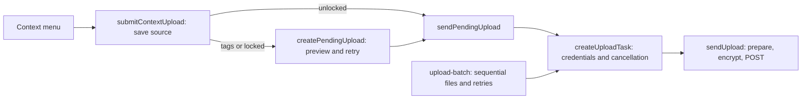

# Frontend audit guide

This is a Svelte 5 + Vite application shared by a browser page and a Firefox
extension. It does not use SvelteKit routing or server rendering. The public
JavaScript API remains `src/lib/index.js`.

## Source map

| Location | Responsibility |
| --- | --- |
| `src/App.svelte` | Compose the application and dispose it on unmount |
| `src/lib/views/` | Library, Settings, and Upload page markup |
| `src/lib/components/` | Cards, inline tags, unlocking, and the image dialog |
| `src/lib/stores/` | State transitions, async actions, cancellation, and resource ownership |
| `src/lib/stores/dom.js` | Small browser adapters for focus, dialogs, validation, and file selection |
| `src/lib/protocol/` | Identity, encryption, tag normalization, framing, and recovery format |
| `src/lib/api.js` | Signed HTTP requests and encrypted API payloads |
| `src/lib/media/` | Bounded reads, media preparation, thumbnails, cover art, and formatting |
| `src/lib/platform/web.js` | Browser storage, downloads, and confirmation adapter |
| `src/extension/` | Firefox APIs, context menus, and extension entry points |
| `src/app.css` | Theme tokens, typography, and shared controls; component styles stay scoped |

Views render store values and invoke actions. Local input drafts are allowed;
components do not fetch, touch storage, manage object URLs, or await workflows.
The tag editor creates a view-scoped store and disposes its presentation state
on unmount. Its save action delegates to the library and media stores.

## Layout spacing

Containers own spacing. Use `.stack` for vertical groups (1rem gap), `.field`
for a label, its control, and optional hint (0.5rem gap), and `.bar` for inline
controls (0.5rem gap). Labels and actions have no implicit form margins. Keep
hints inside their field and associate them with `aria-describedby`. Disclosures
need an explicit gap between their summary and body. Component-specific layout
stays in its Svelte style block, using the project rem scale.

This applies the proximity and consistent-scale guidance in
[Spectrum spacing](https://spectrum.adobe.com/page/spacing/) and
[GOV.UK spacing](https://design-system.service.gov.uk/styles/spacing/): related
labels, controls, and hints sit closer together than separate fields or actions.
The shared primitives implement those relationships with CSS gap.

## Ownership and transitions

- **Application:** creates the session and settings stores; retains one library
  across Library/Settings navigation. Context-menu windows also retain one
  pending upload and its tag draft across views and history; their Upload link
  preserves the source ID. Application disposal releases both workflows.
- **Session:** loading → configured/locked/unlocked. Only one mutation can run
  locally, and the `i2nclip-session` Web Lock serializes mutations across pages.
  Each mutation rereads persistent storage inside the lock. Refresh revisions
  ignore old snapshots; disposal aborts work before further writes.
- **Library search:** idle → loading → results/empty/error. A new search aborts
  its predecessor and changes the revision. More uses the submitted query,
  permits one request, and deduplicates overlapping IDs. Replacing results or
  changing credentials disposes media stores and clears the preview.
- **Upload batch:** idle → uploading one file at a time → idle with failed files.
  Failed files keep their source for retry. Each attempt encrypts with a fresh
  nonce, so retrying normally creates a new content hash. An exact sealed
  payload duplicate returns a conflict; after a lost successful response,
  refresh the library before retrying to avoid creating another copy. Credentials changes abort
  the batch, clear retry sources, and prevent late completions from refreshing
  another library. Progress is accepted only for the active batch and file.
- **Media:** idle → one of reveal/download/retag/delete → idle or deleted.
  One action at a time; decrypted bytes and URLs belong to the media store.
  Cached bytes survive navigation. Disposal aborts downloads and revokes URLs;
  deleted cards remain faded until the next search.
- **Popup:** preparing → available → uploading → uploaded, or available with an
  error. Automatic upload waits for both preparation and unlocking and starts
  once. A failed automatic attempt requires an explicit retry. Tagged popups
  wait for submission after unlocking. Successful upload removes only its own
  source ID. A library/server change during preparation disables automatic send
  until explicit submission. Superseded requests cannot update progress or close
  the window.
- **Context menu:** persist a source with its own ID before uploading or opening
  a popup. Immediate upload success removes that ID; failure retains it and opens
  a popup with the error for explicit retry. Library changes cancel the transfer,
  and reset-cleared sources are not recreated. Notification failure after success
  does not trigger retry.
- **Tags:** closed → editing → saving → editing or closed. Failed drafts survive
  blur; newer drafts are not cleared by an older save. Escape cancels. Normalized
  duplicates preserve the first spelling. Unmounted editors cannot steal focus.

The stores use ordinary JavaScript and Svelte's readable store contract so the
async transitions can be tested directly with deferred promises, without a
component compiler or a separate state-machine dependency.

Creation persists `pendingRegistration` (server URL, public key, and wrapped
private key) before contacting the API. Retries unwrap the same identity and
use a signed list request to confirm registration before spending an invitation.
The password and invitation are not persisted. The final local identity and
cleared pending marker are written together; a session-write failure leaves a
locked identity that can be unlocked or backed up. Pending creation must be
finished or explicitly discarded before restoring or changing servers.

Tab-injected media fetches register a separate abort controller per request in
the extension's isolated frame context. Caller cancellation aborts the remote
fetch; completion and failure release the stream reader and remove frame state.

The upload path is:



- `context-upload.js` saves a source under its own ID and chooses immediate
  transfer or a popup. It records a failure and opens explicit retry.
- `pending-upload.js` owns popup preparation, preview URLs, tags submission,
  and retry. Its session observer controls automatic-send policy; the shared
  task cancels active submissions. The popup alone decides when to close.
- `media/upload-workflow.js` owns credential-bound tasks, cancellation, and
  late-progress suppression. Its `sendPendingUpload` completes background and
  popup transfers under an exclusive `i2nclip-pending-upload:<id>` Web Lock,
  rereads the pending entry before preparing or sending, clears only that ID,
  and sends a notification after releasing the lock.
  Callers retain the task through completion and dispose it in `finally`.
- `media/upload.js` accepts named options, reads bounded bytes, generates a
  thumbnail, and calls the encryption/API layer. A prepared source reuses its
  blob, so upload retries do not fetch it again.
- `upload-batch.js` owns sequential batch progress and failed files, using one
  shared task per batch. The library delegates upload actions, merges batch
  state into its existing interface, and refreshes results after successes.

Pending sources are retained after both preparation and transfer failures.
Preparation failures retry only on explicit submission, including unlock popups.
If another page holds the same pending ID, submission immediately reports that
it is uploading elsewhere and preserves the tag draft for an explicit retry.
It does not queue or automatically resend after the other attempt fails. A page
that cached a completed or reset-cleared source disables submission when the
storage recheck finds it missing. Different pending IDs can upload independently.
Web Locks are required for pending submissions; unavailable coordination reports
an error and keeps the source. Cancellation retains the lock until the underlying
work settles, so ignored cancellation cannot permit another concurrent sender.
Retries encrypt again with fresh randomness, creating a new content hash. A lost
successful upload response can therefore lead to a duplicate item on retry;
check the library before retrying an ambiguous failure. The server returns 409
only when the same sealed-content hash is posted again.


## Verification

Use the Node version in `.nvmrc`, then `npm ci --prefix client` from the repo root.
`make test` runs client tests, the Svelte checker, and Rust tests.
`make test-all` from the repo root runs every suite, including package checks,
PostgreSQL integration/resource tests, Firefox tests, and the live deployment smoke test.
`make test-e2e` provisions PostgreSQL and installs browser dependencies.
`make extension` builds the XPI without minifying JS or CSS.
`npm run e2e --prefix client` rebuilds and runs Firefox against the real local API.

Browser tests are split by settings, library, and popup behavior. `e2e/fixtures.js`
owns the API server, storage shim, and shared helpers. Screenshots are written to
ignored `e2e/shots/`; review both themes at desktop, 360 px, and 320 px widths.
The mixed-media test includes landscape, portrait, panorama, playable WAV/WebM,
long names, files, and playback controls. Its video fixture is a one-second test
pattern; FFmpeg is not needed to run tests.

Deferred-promise tests exercise ignored cancellation, stale search and upload
completion, old progress callbacks, identity/server changes, disposal, duplicate
submissions, overlapping pages, and failure/retry. Firefox tests cover form
validation, recovery failures, encryption flows, navigation, modal focus,
inline editing, upload errors, and layout constraints.

Organization follows the shared `src/lib` convention from
[SvelteKit's structure guide](https://svelte.dev/docs/kit/project-structure),
without adding SvelteKit to this Vite project. See also Svelte's guidance on
[stores for async flows](https://svelte.dev/docs/svelte/stores) and
[derived state, effects, props, and scoped styles](https://svelte.dev/docs/svelte/best-practices).

## Node CLI

The CLI imports the same public API and encryption libraries as the extension.
Use Node 22.23.3 from `.nvmrc`; source execution needs no build or additional dependencies.
Run `node client/cli/index.js --help` from the repository root, or
`npm run cli --prefix client -- --help`.

The encrypted recovery file defaults to `$XDG_CONFIG_HOME/i2nclip/recovery.json`,
or `~/.config/i2nclip/recovery.json` when XDG_CONFIG_HOME is unset, empty, or relative.
Copy the recovery file downloaded by the extension there, or pass
`--recovery /path/to/i2nclip-recovery.json` to any command. The CLI uses the server
URL in that document and does not store your password or plaintext identity.
New recovery files use mode 0600 and the automatically created directory uses
0700. Existing recovery files are never overwritten.

Passwords are prompted without echo. For scripts, use `--password-file PATH`,
including `/dev/stdin`; one trailing line ending is removed. Creating a library
requires at least eight password characters and confirmation when prompted.
Creation saves the encrypted recovery file before registration. If registration
fails, use `register` with the same recovery file to retry safely.

```sh
node client/cli/index.js create --server https://clip.example.com --otc INVITATION
node client/cli/index.js register --otc INVITATION
node client/cli/index.js list --tags 'photos,holiday'
node client/cli/index.js list --after CURSOR
node client/cli/index.js upload ./photo.jpg --tags 'photos,holiday'
node client/cli/index.js download ID --output ./saved-photo.jpg
node client/cli/index.js tags ID --add 'Favorite' --remove 'holiday'
node client/cli/index.js tags ID --tags 'photos,Favorite'
node client/cli/index.js tags ID --tags ''
node client/cli/index.js delete ID
```

Replace `ID` with a media ID from list/upload output. List returns one page as
JSON `{items, next}`; pass the next cursor with the same search to continue.
Other commands also emit JSON to stdout. Prompts and errors use stderr.
Exit codes are 0 for success, 1 for an operational failure, 2 for invalid command
arguments, and 130 for interruption. Ctrl-C aborts the active request.
Downloads require an explicit path and never overwrite existing files.

Upload accepts exactly one local file, at most 32 MiB. It stores the filename,
content type and tags without generating browser thumbnails. Override content
sniffing with `--content-type TYPE`. Handle batches externally, for example:

```sh
for file in ./photos/*; do
  node client/cli/index.js upload "$file" --tags photos --password-file /path/to/password || break
done
```

Tag editing reads `GET /api/media/{id}/meta` directly and updates through
`PUT /api/media/{id}/meta`, preserving other metadata and the thumbnail. A
concurrent edit produces an error; rerun to fetch the latest tags. The old
`PUT /api/media/{id}` route has been removed; update the server and extension
together.

## Distributable builds

`make packages` from this directory builds and packages web, Firefox extension,
and Node CLI targets. Use `make web`, `make extension`, or `make cli` individually.
All output is under `client/dist/`: `i2nclip-web.zip`, `i2nclip.xpi`, and
`i2nclip-cli.tar.gz`, alongside their `web/`, `extension/`, and `cli/` build directories.
`make build` builds all directories without creating archives.

The web archive contains only static HTML and bundled JS/CSS. The extension
contains its manifest, four page shells, SVG icon, and bundled JS/CSS; update
metadata and unused assets are excluded. The CLI contains one executable Node
ESM bundle with its reachable protocol/API code; Node built-ins stay external,
and no npm dependencies are required after extraction.

The current source boundaries are retained: `src/main.js` is the web entry point,
`src/extension/` owns Firefox entry points, and `cli/` owns Node entry points.
`src/lib/index.js` remains the shared public API. No runtime protocol changes
are made by bundling.

Run `make test-packages` to build and check all packages. See the repository README's
Client packages section for hosting requirements and CLI extraction instructions.

The server container builds only the web target and serves it through the Rust
listener alongside `/api/`. `I2N_WEB_DIR` selects its static directory; local
source execution defaults to `client/dist/web`. Browser E2E builds web, extension,
and CLI artifacts and tests the web client on the Rust listener's own origin.

Session storage, identity-operation ownership, and the retained generation checks
are described in [the session service guide](../doc/session.md).
